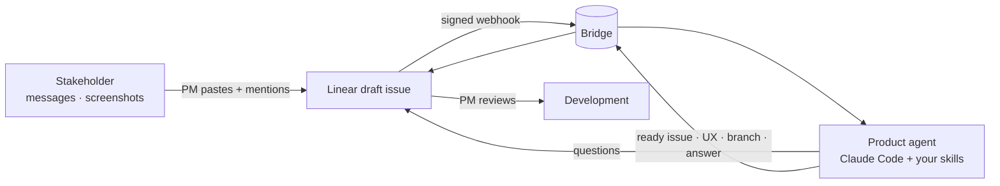

<div align="center">

# specforge

**Forward the messy request. Get back a ready-to-build issue.**

specforge is a product-analyst agent that lives in **Linear**. Paste what your stakeholders sent (loose chat messages, screenshots, one-liners), mention the agent, and get back an issue a developer can pick up without asking anything. It is enriched, deduplicated, grounded in your codebase, and backed by evidence. When the request needs a UX proposal, a redesign or a written answer, it produces that too.

[](https://github.com/itsRon4ld/specforge/actions/workflows/ci.yml)
[](LICENSE)


[How it works](#how-it-works) · [Request types](#request-types) · [Quickstart](#quickstart) · [Your skills](#bring-your-own-skills) · [Security](#security-model)

</div>

---

## Why

Requests rarely arrive as specs. They arrive as a burst of chat messages from a founder, a screenshot from a customer, or "can we also…" in a meeting. Someone on the product team has to:
- turn that into a real requirement;
- check whether it already exists;
- find the code involved;
- write acceptance criteria;
- chase the missing details;
- and sometimes mock up the UX or answer a question in a spreadsheet.

specforge does that work, and keeps the PM in charge of the decisions:

- **One gesture.** Paste the raw messages into an issue and mention `@specforge`. That's it.
- **It asks instead of guessing.** Missing details become numbered questions in the Linear session, each with a suggested answer you can confirm.
- **Grounded in reality.** It searches your backlog for duplicates and your codebase for what already exists, and names the files a developer will touch.
- **Knows production from development.** It compares both branches to tell whether a bug hits users today, whether it's already fixed upstream, and whether it needs a hotfix.
- **A real Definition of Ready.** The bridge refuses to publish an issue that is missing a required section.
- **The PM decides.** UX and redesigns wait for your approval. Ready issues land in the backlog for you to review and schedule.

## How it works



1. **Paste.** Create an issue with whatever the stakeholder sent, and mention the agent or delegate the issue to it.
2. **Read and classify.** The agent reads the text and the screenshots, and picks a type: feature, bug, UX, redesign or question.
3. **Ask.** If something is missing, it asks you in the session and parks the issue in *Needs Info*.
4. **Ground.** It searches Linear for duplicates and the codebase for what already exists.
5. **Enrich.** It applies your team's enrichment skill and fills the template for the type.
6. **Deliver.** It publishes through the readiness gate. Your review comes next: move the issue to development when you agree.

## Request types

| Type | What you get | Gate |
|---|---|---|
| 🧩 **Feature** | Problem, users, Given/When/Then criteria, out-of-scope, technical notes with real file paths; sub-issues for big requests | You schedule it |
| 🐞 **Bug** | Steps, expected vs. actual, attached evidence, suspected area in the code, and a **target branch**: next release or hotfix on production | You schedule it |
| 🎨 **UX** | Flow and screens document plus a clickable HTML prototype, then the ready issue | You approve the UX |
| 🖌️ **Redesign** | The redesign applied on a `design/*` branch, then an issue linking it for a developer | You approve the redesign |
| ❓ **Question** | An answer from your codebase as a Word or Excel file, saved to a knowledge base for next time | — |

Every issue keeps the stakeholder's original words in a collapsible **Original request** section. The agent also adds any of your **existing labels** that apply (customer, area…), following each label's description in Linear. It never creates new ones.

## Quickstart

**Prerequisites:** Docker, admin access to a Linear workspace, the product's GitHub repo, and an Anthropic API key.

```bash
git clone https://github.com/itsRon4ld/specforge && cd specforge
cp .env.example .env && cp config.example.yaml config.yaml

# Install the Linear agent (prints LINEAR_ACCESS_TOKEN)
LINEAR_CLIENT_ID=… LINEAR_CLIENT_SECRET=… pnpm setup:linear

echo "PRODUCT_TOKEN=$(openssl rand -hex 32)" >> .env
docker compose up -d --build
```

Point the Linear app webhook at `https://<bridge>/hooks/linear`. The full walkthrough is in [docs/setup.md](docs/setup.md).

## Configuration

Everything specific to your team lives in [`config.yaml`](config.example.yaml):

```yaml
linear:
  team: PRD
  states: { backlog: Backlog, needsInfo: Needs Info, needsApproval: In Review, answered: Done }
  labels: { feature: Feature, bug: Bug, ux: UX, redesign: Redesign, question: Question, hotfix: Hotfix }
  knowledgeIssue: PRD-1
approvals:
  approvers: [<your-linear-user-id>]
github:
  repo: your-org/your-app
  branches: { development: dev, production: main }
  designBranchPrefix: design/
agent:
  model: claude-opus-5-5
  guidance: |
    Our customers are companies; each company is a tenant.
  # Version your setup next to your code (optional):
  skillsPath: infra/specforge/skills
  templatesPath: infra/specforge/templates
  contextPath: infra/specforge/context.md
readiness: # Definition of Ready: required ## headings per type
  feature: [Problem, Users, Acceptance criteria, Out of scope, Technical notes, Target branch]
```

## Bring your own skills

How your team writes requirements is yours. specforge loads every folder in [`packages/agent/skills`](packages/agent/skills) as a Claude Code skill:

- `enrich-requirement`: ships as a solid default (problem framing, gap checklist, Given/When/Then, INVEST splitting). Replace it with your own process.
- Add a `redesign` skill with your design-system rules, and the agent uses it for redesign requests.
- Keep your whole setup in a **private setup repository** and point `SETUP_REPO_URL` at it (recommended):

  ```
  your-specforge-setup/   (private)
    config.yaml           team, states, labels, approvers (no secrets)
    context.md            your product map: customers, roles, modules, glossary
    skills/               enrich-requirement, redesign, …
    templates/            feature.md, bug.md, ux.md, redesign.md, question.md
  ```

  The agent refreshes it before every job, so a pushed change applies to the next request.
- Or version it inside your product repo with `agent.skillsPath` / `templatesPath` / `contextPath`, or mount a folder and set `SKILLS_DIR`.

The agent also reads your repo's root `CLAUDE.md`, so your architecture notes double as its codebase map.

## Security model

The agent reads text that other people wrote, so policy is enforced in code rather than in the prompt:

- **The agent holds no Linear or GitHub credentials.** It acts only through the bridge.
- **The Definition of Ready is a bridge check.** It is the only path to the backlog.
- **The agent can only park issues.** Moving work to development is a human decision.
- **Approvals are verified against Linear user ids.** Only `design/*` branches are pushed, and only Linear uploads are downloaded.

See [SECURITY.md](SECURITY.md) and [docs/architecture.md](docs/architecture.md).

## Project layout

```
packages/
  bridge/              webhook, policy, queue, Linear + GitHub clients
    src/security.ts    Definition of Ready, route matrix, approvals, branch and upload guards
    src/routes.ts      internal agent API
  agent/
    src/runtime.ts     job loop → Claude Code via the Claude Agent SDK
    src/cli.ts         `specforge` CLI used by the agent
    instructions/      product.md, the analyst's playbook
    templates/         feature · bug · ux · redesign · question
    skills/            your team's skills (enrich-requirement placeholder)
docs/                  architecture and setup
```

## Roadmap

- [ ] Slack and WhatsApp intake (forward messages without opening Linear)
- [ ] Hand-off to a coding agent when an issue moves to *Ready for development* (for example [tracefix](https://github.com/itsRon4ld/tracefix))
- [ ] Error-tracker lookup for bug reports (GlitchTip / Sentry)
- [ ] Figma export for UX proposals
- [ ] Weekly digest of incoming requests per stakeholder

## Contributing

Issues and PRs are welcome. Please read [CONTRIBUTING.md](CONTRIBUTING.md) first.

## License

[MIT](LICENSE) © Ronald Alfredo Hurtado Lago
