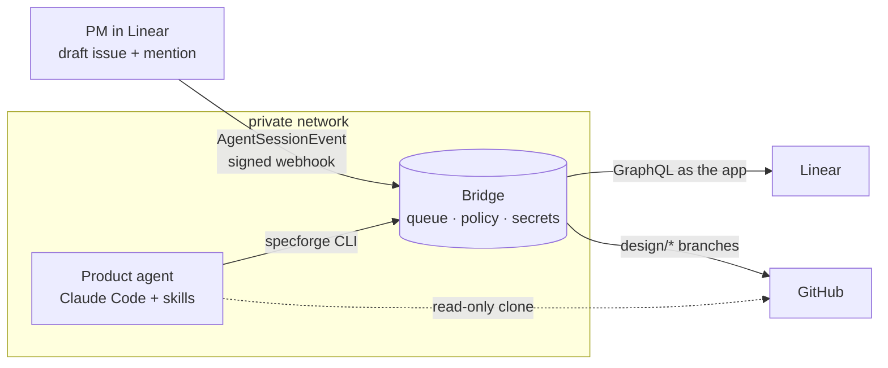
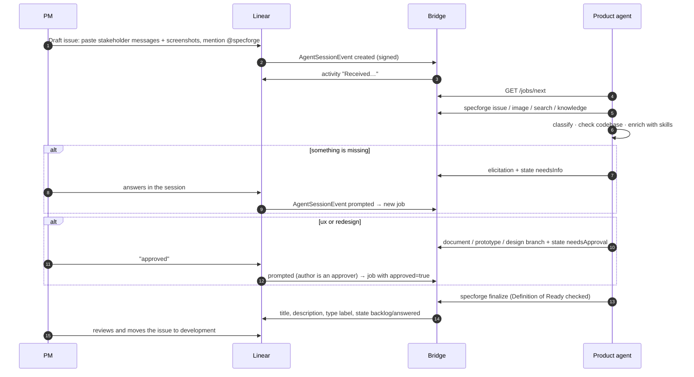

# Architecture

specforge has two parts: a **bridge** that holds every credential and enforces policy, and a **product agent** that holds none.

## Request lifecycle

## Bridge (`packages/bridge`)

| Surface | Route | Protection |
|---|---|---|
| Public | `POST /hooks/linear` | `Linear-Signature` HMAC and a timestamp no older than 60 s |
| Internal | `/jobs/*`, `/linear/*`, `/github/branch` | role bearer token + route matrix |

- **Definition of Ready.** `/linear/finalize` and `/linear/subissue` check that the description contains every required `##` heading for its type, plus the original request. Otherwise they answer `422` and list the missing sections. The agent cannot reach `backlog` or `answered` in any other way.
- **Approvals.** For a `prompted` event, `approved` is computed from the author's Linear id and the exact message. It reaches the agent inside the job, and the agent cannot fake it.
- **Write scope.** Each job can only change its own draft issue and the sub-issues it creates, and can only post in its own agent session. Text injected into a draft cannot make the agent edit other issues.
- **Labels.** Besides the type and hotfix labels, which it manages itself, the bridge lets the agent add any label that already exists in Linear. It checks names against the live list on every call and never creates labels.
- **Uploads.** The bridge downloads files only from `uploads.linear.app`, so the agent cannot use the bridge's token against other hosts.
- **Git.** The bridge imports a git bundle and pushes only `design/*` branches. It never opens PRs and never touches the base branch.

## Agent (`packages/agent`)

| | |
|---|---|
| Runtime | Claude Code through the Claude Agent SDK (`claude_code` preset + `instructions/product.md`) |
| Workspace | Per-job folder with `.claude/skills` and `out/`, plus clean read-only checkouts of the **development** and **production** branches (partial clone + worktree) |
| Codebase context | The repo's root `CLAUDE.md` (or `AGENTS.md`, or `README.md`) is added to the instructions; nested ones are read on demand |
| Skills | Loaded as project skills: your enrichment and redesign processes |
| Templates | `<type>.md` matching the Definition of Ready, in any language |
| Context | Optional `context.md`: your product map (customers, roles, modules, glossary) |
| Source precedence | `SKILLS_DIR`/`TEMPLATES_DIR`/`CONTEXT_FILE` → setup repo (`SETUP_REPO_URL`) → paths inside the product repo → bundled defaults |
| Tools | Bash, Read, Write, Edit, Glob, Grep, Skill, TodoWrite, and the `specforge` CLI |
| States it can set | `needsInfo`, `needsApproval` (the rest only through `finalize`) |

## Request types

| Type | Deliverable | Human gate |
|---|---|---|
| `feature` | Ready issue (with sub-issues if large) | PM moves it to development |
| `bug` | Ready issue with reproduction and evidence | PM moves it to development |
| `ux` | UX document + HTML prototype, then a ready issue | PM approves the UX |
| `redesign` | `design/*` branch with the redesign, then a ready issue linking it | PM approves the redesign |
| `question` | Word/Excel answer attached, saved to the knowledge base | none |

## Target branch and hotfixes

Feature and bug issues must state a **target branch**. The agent compares the production checkout (what users run) with the development checkout (the next release):

| Situation | Target |
|---|---|
| New work, or a bug that can wait | development |
| Bug hurting users now | production (hotfix) |
| Bug in production already fixed in development | production (hotfix by cherry-pick) |
| Bug only in development | development; production is not affected |

Hotfixes get the optional `hotfix` label. Whether something is urgent enough for a hotfix is confirmed with the PM.

## Design choices

- **Linear as the interface.** The PM never leaves Linear. Questions, approvals and results all live in the agent session.
- **Policy in the bridge, not the prompt.** Readiness, approvals, states and branches are enforced in code. Prompt injection cannot get around them.
- **Skills as the team's playbook.** How your team enriches requirements or redesigns screens is a skill file you own, not code in this repository.
- **No build step.** Node 24 runs TypeScript directly.
